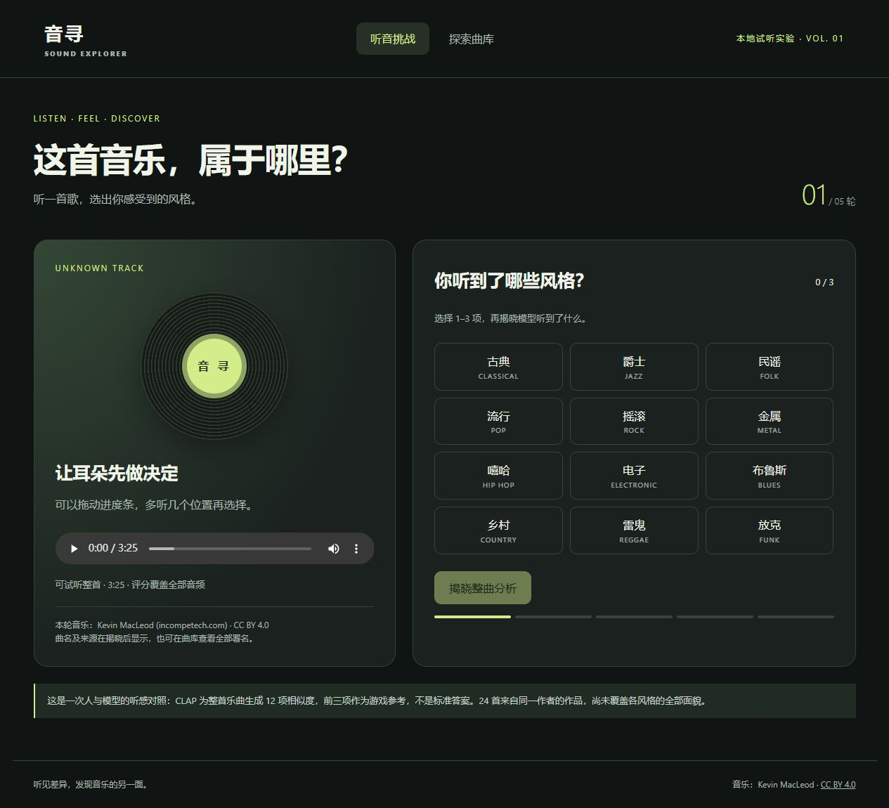

# 音寻 · Sound Explorer

一个用耳朵探索音乐风格的本地原型，灵感来自 [Every Noise at Once](https://everynoise.com/engenremap.html)。

- **听音挑战**：每局随机 5 首，从 12 个风格中选择 1–3 项，揭晓整曲分析。
- **探索曲库**：搜索、按模型首选风格筛选、播放完整音乐、查看全部 12 项相似度。
- **听感反馈**：记录在浏览器本地，不上传。
- **24 首授权音乐**：来源与许可记录在 `catalog_sources.json`，应用内逐曲署名。

## 快速试玩

需要 Python 3.10+。下载曲库需要网络，运行网页不需要 GPU 或数据库。

```powershell
python -m pip install requests soundfile
python build_catalog.py
python serve.py
```

打开 http://127.0.0.1:8765 。仓库内 `web/catalog.json` 是已生成的整曲分析结果；原始音频通过脚本从作者官网下载，不包含在仓库中。服务只监听本机，支持音频拖动播放。

## 重新分析

请按 [PyTorch 官方指引](https://pytorch.org/get-started/locally/) 安装匹配的 CUDA 版本。此版分析脚本要求 NVIDIA CUDA；纯网页试玩无此要求。

```powershell
python -m pip install torch==2.9.1+cu128 torchvision==0.24.1+cu128 --index-url https://download.pytorch.org/whl/cu128
python -m pip install -r requirements.txt
python build_catalog.py --analyze
# 模型已缓存后可完全离线分析：
python build_catalog.py --analyze --offline
```

首次分析下载 `laion/clap-htsat-unfused` 的固定版本 `8fa0f1c6d0433df6e97c127f64b2a1d6c0dcda8a`。预训练权重保存在 `.cache`；本项目不训练 CLAP，也不上传音频。

## 整曲评分

1. 完整读取音频，混为单声道并重采样至 48 kHz。
2. 按不重叠的 10 秒窗口编码，每批 4 个窗口。
3. 将归一化窗口向量按有效时长加权平均，再归一化，得到一个 512 维整曲向量。尾窗以实际时长计权。
4. 与 12 个风格描述的文字向量计算余弦相似度，每首只输出一组 12 项评分。

风格：古典、爵士、民谣、流行、摇滚、金属、嘻哈、电子、布鲁斯、乡村、雷鬼、放克。提示词保存在 `experiment.py` 的 `LABELS` 中，也随分析结果保存。

**相似度不是概率，模型前三项不是标准答案。** 游戏匹配分 = `1000 × 2 × 命中前三项的数量 ÷ (选择项数 + 3)`，满分 1000/轮。这个分数衡量与模型的一致程度，不衡量音乐知识或识别准确率。

这批音乐来自同一作者，以器乐为主，不能代表各风格整体分布，尤其缺乏人声说唱样本。当前提示词含有人声描述，会影响器乐的得分。下一步应补充不同作者与人声样本，人工审核标签，再评估提示词和聚合方法。

## 文件

- `build_catalog.py`：下载、校验、整曲推理与结果缓存。
- `experiment.py`：最初 3 个 librosa 示例的复现实验及风格描述。
- `serve.py`：只提供网页与曲库音频的本地服务，支持 HTTP Range。
- `web/`：无构建工具依赖的页面、交互和已生成分数。
- `catalog_sources.json`：24 首音乐的来源、描述、ISRC 和许可。
- `outputs/catalog/`：本机生成的整曲向量和结果，不提交 Git。

当前不依赖 PostgreSQL。后续可将曲库与反馈接入数据库，将预计算结果部署至小型服务器；服务器无需实时运行 CLAP。

## 许可与署名

项目代码采用 [MIT License](LICENSE)。**MIT 不覆盖第三方音频、预训练权重及来源元数据。**

音乐：Kevin MacLeod ([incompetech.com](https://incompetech.com/music/royalty-free/music.html))。每首曲名列于 `catalog_sources.json`，应用内提供逐曲署名。

Licensed under Creative Commons: By Attribution 4.0 — https://creativecommons.org/licenses/by/4.0/

官方授权说明：https://incompetech.com/music/royalty-free/licenses/ 。音频未经剪辑；分析中进行重采样和向量聚合。模型许可见 [官方模型页](https://huggingface.co/laion/clap-htsat-unfused)。

原始三个 librosa 示例有各自许可；其中 Choice 含非商业限制，不在这 24 首试玩曲库中。

## 模型选型记录

`laion/larger_clap_music` 在早期 CPU/GPU 实验中出现文字向量近乎恒定的问题，未用于本原型。参见 [相关问题报告](https://github.com/embeddings-benchmark/mteb/issues/5069)。改用上述固定版本通用 CLAP，并在推理前检查文本向量是否整体坍缩。

## 验证记录（2026-10-14）

- 24 个完整解码音频，共约 77.5 分钟；每首恰好 12 项分数及一个归一化的 512 维向量。
- 浏览器实际播放成功；最多选择 3 项、五轮结算、重新开始、曲库搜索和风格筛选已验证。
- 本地 HTTP 资源、音频范围请求、越界请求及非公开文件访问限制已检查。
- 模型首选分布：爵士 7、雷鬼 5、金属 3、流行 2、摇滚 2、嘻哈 2、古典 1、乡村 1、电子 1。这是结果分布，不是正确率。
- 例如 Metalmania 的 metal 得分 0.712；Hall of the Mountain King 的 jazz 0.491 高于 classical 0.467，说明仍需人工审听和改进提示词。



